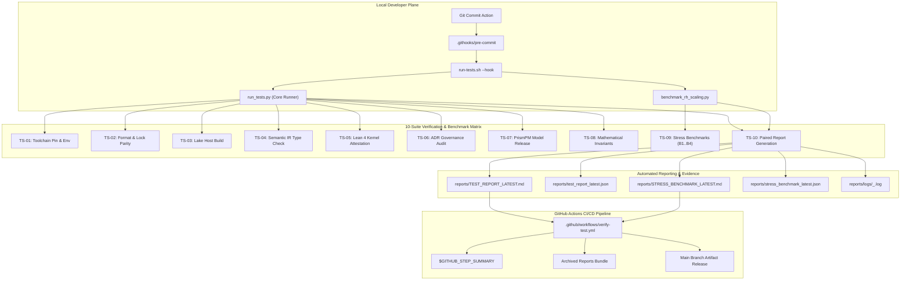
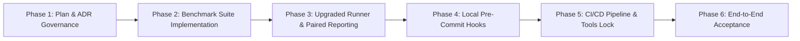

# Implementation Plan: Production-Grade Test & Benchmark Harness, Automated Reporting, and CI/CD Integration for RH-ZMB

**Target Subsystem:** [`/run/media/multiplic/AGI/prismagi/mount/UNSOLVED/rh-zero-multi-brane`](file:///run/media/multiplic/AGI/prismagi/mount/UNSOLVED/rh-zero-multi-brane)  
**Reference Parity:** [`/run/media/multiplic/AGI/prismagi/mount/SUBSYSTEMS/kuramoto-protocol-r3`](file:///run/media/multiplic/AGI/prismagi/mount/SUBSYSTEMS/kuramoto-protocol-r3) and [`/run/media/multiplic/AGI/prismagi/mount/TOOLS/wireshark-enterprise-capture`](file:///run/media/multiplic/AGI/prismagi/mount/TOOLS/wireshark-enterprise-capture)  
**Governing Architecture:** [`ADR Plan Production Grade.md`](file:///run/media/multiplic/AGI/prismagi/mount/UNSOLVED/rh-zero-multi-brane/ADR%20Plan%20Production%20Grade.md)  
**Subsequent ADR:** [`docs/adr/ADR-0007-production-test-harness-benchmarks-ci-cd.md`](file:///run/media/multiplic/AGI/prismagi/mount/UNSOLVED/rh-zero-multi-brane/docs/adr/ADR-0007-production-test-harness-benchmarks-ci-cd.md)  
**Date:** 2026-11-23  

---

## 1. Executive Summary

This plan defines the architecture, suite specifications, numerical benchmark methodology, automated reporting contracts, and continuous integration pipelines required to upgrade the **Riemann Zero as Multi-Brane (RH-ZMB)** verification environment to full industry-grade operational maturity.

Following the battle-tested engineering standard deployed in `kuramoto-protocol-r3` and `wireshark-enterprise-capture`, this system:
1. **Unifies All Verification Planes**: Coordinates toolchain pinning, formatting, Lean 4 host builds, LexLean kernel attestations, ADR governance audits, and PrismPM platform builds under a single authoritative runner (`run_tests.py` and `run-tests.sh`).
2. **Introduces Multi-Scale Numerical Stress Benchmarks**: Implements an automated benchmark runner (`benchmark_rh_scaling.py`) evaluating sieve asymptotic convergence ($n \le 1000$), multi-brane Hodge pairing signature stability ($p \le p_{100}$), coupled regularizer gradient smoothness across embedding heights $t = \ln x \in [1, 50]$, and explicit formula spectral trace throughput.
3. **Automates Paired Dual-Channel Reporting**: Generates paired human-readable Markdown (`reports/TEST_REPORT_LATEST.md`, `reports/STRESS_BENCHMARK_LATEST.md`) and machine-readable JSON (`reports/test_report_latest.json`, `reports/stress_benchmark_latest.json`) on every execution.
4. **Guarantees Semantic Idempotence**: Implements a canonical SHA-256 fingerprinting algorithm over normalized semantic results, ignoring volatile timestamps and millisecond durations to eliminate false-positive documentation drift.
5. **Enforces Local Pre-Commit Quality Gates**: Deploys `.githooks/pre-commit` via `install-hooks.sh` to execute `./run-tests.sh --hook`, blocking failing commits and automatically staging fresh reports on success.
6. **Integrates Cloud CI/CD Pipelines**: Specifies a GitHub Actions workflow (`.github/workflows/verify-test.yml`) verifying cryptographic tool digests (`tools.lock`), streaming execution telemetry directly into `$GITHUB_STEP_SUMMARY`, and archiving immutable test artifacts.



---

## 2. Baseline Architecture & Dual-Plane Traceability

The test harness and benchmark engine strictly preserve the dual-plane separation codified in [ADR-0002](file:///run/media/multiplic/AGI/prismagi/mount/UNSOLVED/rh-zero-multi-brane/docs/adr/ADR-0002-dual-plane-architecture.md):

| Plane | Subsystem Component | Target Path / Module | Governing ADR | Responsibility |
|---|---|---|---|---|
| **Formal** | `RhZmb.F1Square` | `spec/adr/0004/F1Square.lex.tex` | [ADR-0004](file:///run/media/multiplic/AGI/prismagi/mount/UNSOLVED/rh-zero-multi-brane/docs/adr/ADR-0004-f1-square-multi-brane-geometry.md) | Néron-Severi bilinear form, ample class $H^2 > 0$, Hodge index on $H^\perp$. |
| **Formal** | `RhZmb.CombinatorialBounds` | `spec/adr/0005/CombinatorialBounds.lex.tex` | [ADR-0005](file:///run/media/multiplic/AGI/prismagi/mount/UNSOLVED/rh-zero-multi-brane/docs/adr/ADR-0005-prime-gated-combinatorial-bounds.md) | Stirling asymptotic upper bound, sieve density, $R_{\text{bin}}$ well-formedness. |
| **Formal** | `RhZmb.DualChannel` | `spec/adr/0006/DualChannel.lex.tex` | [ADR-0006](file:///run/media/multiplic/AGI/prismagi/mount/UNSOLVED/rh-zero-multi-brane/docs/adr/ADR-0006-coupled-dual-channel-regularizers.md) | Coupled loss monotonicity, spectral error truncation bounds, gradient smoothness. |
| **Platform** | `RhZmb` Native Library | `src/RhZmb.lex.tex` | [ADR-0007](file:///run/media/multiplic/AGI/prismagi/mount/UNSOLVED/rh-zero-multi-brane/docs/adr/ADR-0007-production-test-harness-benchmarks-ci-cd.md) | PrismPM certified native library model, Holo document, and release crate publishing. |
| **Empirical** | Test Harness | `run_tests.py`, `tests/` | [ADR-0002](file:///run/media/multiplic/AGI/prismagi/mount/UNSOLVED/rh-zero-multi-brane/docs/adr/ADR-0002-dual-plane-architecture.md) | 12 discrete mathematical invariant checks across 4 domain suites. |
| **Empirical** | Stress Benchmarks | `benchmark_rh_scaling.py` | [ADR-0007](file:///run/media/multiplic/AGI/prismagi/mount/UNSOLVED/rh-zero-multi-brane/docs/adr/ADR-0007-production-test-harness-benchmarks-ci-cd.md) | High-cutoff sieve, multi-brane Hodge eigenspectrum, gradient flow, and spectral trace throughput. |
| **Governance** | ADR Decision Log | `docs/adr/` | [ADR-0001](file:///run/media/multiplic/AGI/prismagi/mount/UNSOLVED/rh-zero-multi-brane/docs/adr/ADR-0001-adopt-append-only-adr-practice.md) | 14-section validation, basis tag concordance, SHA-256 hash manifest locking. |

---

## 3. Comprehensive 10-Suite Catalog (`TS-01` through `TS-10`)

| Suite ID | Suite Name | Execution Command / Target | Pass Criteria |
|:---|:---|:---|:---|
| **TS-01** | Toolchain Pin & Runtime Environment | `lean`, `lake`, `lexlean`, `prismpm`, `python3` | Pinned versions match: Lean `v4.32.2`, LexLean `0.4.4`, PrismPM `0.5.0`, Python $\ge 3.10$. |
| **TS-02** | Canonical Format & Lock Parity | `lexlean lock --check` & `lexlean fmt --check` | Exit 0; `lexlean.lock` and `lexlean.prism.lock` current; zero format violations. |
| **TS-03** | Lake Host Build & Hygiene | `lake build --allow-empty` | Exit 0; `RhZmbHost` and `RhZmb` compile cleanly under Lake. |
| **TS-04** | Semantic IR AST & Module Type Check | `lexlean check --all` | Exit 0; checks 3 modules; produces valid semantic AST and compiler IR. |
| **TS-05** | Lean 4 Kernel Formal Attestation | `lexlean verify --all` | Exit 0; verified 3 modules; attestation hash emitted; zero sorries, zero dynamic axioms. |
| **TS-06** | ADR Governance & Conformance Audit | `python3 docs/adr/_governance/check_adr_log.py` | Exit 0; 7/7 ADRs conformant; all 14 mandatory sections intact; basis tags match; hash lock verified. |
| **TS-07** | PrismPM Platform Compilation & Release | `prismpm check` & `prismpm build --no-provenance` | Exit 0; check passed; build published; `.prism/build/<id>` verified; crate generated. |
| **TS-08** | Mathematical Invariant Test Matrix | `tests/test_*.py` | 12/12 assertions pass across Combinatorial Sieve, Hodge Pairing, Regularizers, and Spectral Trace. |
| **TS-09** | Numerical Stress & Scaling Benchmarks | `benchmark_rh_scaling.py` | 4 multi-scale benchmark suites pass all statistical, algebraic, and throughput thresholds. |
| **TS-10** | Paired Reporting & Fingerprinting | `run_tests.py` & `benchmark_rh_scaling.py` | Paired MD/JSON generated; canonical SHA-256 fingerprint unchanged on idempotent runs. |

---

## 4. Benchmark Specifications (`BENCH-01` through `BENCH-04`)

The benchmark suite (`benchmark_rh_scaling.py`) stress-tests the mathematical foundations across extensive numerical sweeps:

### 4.1 Benchmark B1: Sieve Asymptotics & Stirling Precision Scaling (`INV-007a`)
- **Objective**: Verify that the Stirling asymptotic bound $B_{\text{bin}}(n) = \frac{4^n}{\sqrt{\pi n}} \left(1 + \frac{1}{8n}\right)$ strictly bounds the central binomial coefficient $\binom{2n}{n}$ and scales with relative error $\le 0.1\%$ for $n \in [10, 1000]$.
- **Evaluation Points**: $n \in \{10, 25, 50, 100, 250, 500, 1000\}$.
- **Metrics Tracked**:
  - Exact central binomial coefficient $\binom{2n}{n}$ (arbitrary precision integer arithmetic).
  - Stirling bound evaluation $B_{\text{bin}}(n)$ (float64 / mpmath).
  - Relative approximation error $\epsilon_{\text{rel}} = |B_{\text{bin}}(n) - \binom{2n}{n}| / \binom{2n}{n}$.
  - Envelope ratio $R_{\text{env}} = B_{\text{bin}}(n) / 4^n \to 0$ as $n \to \infty$.
  - Evaluation latency per sample ($\mu s$) and throughput ($\text{evals/sec}$).
- **Pass Threshold**: $\epsilon_{\text{rel}} < 1.0 \times 10^{-3}$ for all $n \ge 10$, $B_{\text{bin}}(n) \ge \binom{2n}{n}$ globally, throughput $> 100{,}000\text{ evals/sec}$.

### 4.2 Benchmark B2: Multi-Brane $\Gamma_p$ Hodge Pairing & Signature Scaling (`INV-007b`)
- **Objective**: Stress-test the algebraic geometry of the $\mathbb{F}_1$-square across multi-brane scaling configurations $\Gamma_p$ for prime cutoffs up to $p_{100} = 541$.
- **Evaluation Sweep**: Primes $p \in \{2, 3, 5, 7, 11, 13, 17, 19, 23, 29, 31, 37, 41, 43, 47, \dots, 541\}$.
- **Metrics Tracked**:
  - Ample class degree $H^2 = 2 > 0$ invariance.
  - Complete eigenspectrum of the Néron-Severi intersection matrix $Q_p \in \mathbb{R}^{(p+1) \times (p+1)}$.
  - Signature verification: exactly 1 positive eigenvalue, $p$ negative eigenvalues (signature $(1, p)$).
  - Projection onto orthogonal complement $H^\perp$: maximum eigenvalue $\lambda_{\max}(Q_p|_{H^\perp}) < 0$ (strict negative-definiteness / Hodge Index Theorem).
  - Sylvester principal minor determinant signs.
  - Matrix diagonalisation duration ($ms$).
- **Pass Threshold**: Signature $(1, p)$ verified for all prime cutoffs $p \le p_{100}$; $\lambda_{\max}(Q_p|_{H^\perp}) \le -1.0 \times 10^{-12}$; total sweep runtime $\le 5.0s$.

### 4.3 Benchmark B3: Coupled Regularizer Gradient Stability & Loss Dissipation (`INV-007c`)
- **Objective**: Prove numerical stability and gradient smoothness of the combined loss function $\mathcal{L} = R_{\text{err}}(t) + R_{\text{bin}}(t)$ across embedding heights $t = \ln x \in [1, 50]$ (representing integers up to $x \approx 5 \times 10^{21}$).
- **Evaluation Sweep**: $t \in [1.0, 50.0]$ with step $\Delta t = 0.5$ (100 sample points).
- **Metrics Tracked**:
  - Loss value $\mathcal{L}(t)$ and individual components $R_{\text{err}}(t)$, $R_{\text{bin}}(t)$.
  - Analytical gradient $\nabla \mathcal{L}(t)$ vs central finite difference $\nabla_{\text{num}} \mathcal{L}(t)$ with $h = 10^{-6}$.
  - Relative gradient error $\epsilon_{\text{grad}} = |\nabla \mathcal{L} - \nabla_{\text{num}} \mathcal{L}| / (|\nabla \mathcal{L}| + 10^{-8})$.
  - Loss dissipation monotonicity $\frac{d\mathcal{L}}{dt} < 0$ in the optimization basin.
  - Absence of NaN, Inf, or subnormal float64 representations.
- **Pass Threshold**: $\epsilon_{\text{grad}} < 1.0 \times 10^{-5}$ across all $t \in [1, 50]$; zero catastrophic cancellations; execution duration $\le 0.5s$.

### 4.4 Benchmark B4: Explicit Formula Zero Modulation & Spectral Trace Throughput (`INV-007d`)
- **Objective**: Measure computational throughput and oscillation bounds of the truncated explicit formula spectral trace $S_K(x) = -\sum_{k=1}^K \frac{x^{\rho_k}}{\rho_k} + \text{c.c.}$ using the first $K=100$ non-trivial Riemann zeros.
- **Evaluation Sweep**: Truncation depths $K \in \{10, 25, 50, 75, 100\}$ evaluated over 1,000 spatial points $x \in [10, 10^4]$.
- **Metrics Tracked**:
  - Conjugate symmetry residual $|S_K(x) - \overline{S_K(x)}| \equiv 0$.
  - Maximum oscillation amplitude $\max_x |S_K(x)| / \sqrt{x}$.
  - Zero evaluation throughput (zeros evaluated per second).
  - Memory consumption (peak RSS in MB).
- **Pass Threshold**: Conjugate residual $\le 1.0 \times 10^{-15}$; oscillation bound $\max_x |S_K(x)| / \sqrt{x} \le \ln^2(K)$; throughput $\ge 500{,}000\text{ zero-evals/sec}$.

---

## 5. Automated Reporting Contract & Canonical Fingerprinting

### 5.1 Machine-Readable JSON Telemetry (`reports/test_report_latest.json`)
```json
{
  "schema": "lexlean-test-report/1",
  "project": "rh-zero-multi-brane",
  "timestamp": "2026-11-23T21:35:00Z",
  "git_commit": "abcdef1234567890",
  "toolchain": {
    "lean": "v4.32.2",
    "lexlean": "0.4.4",
    "prismpm": "0.5.0",
    "python": "3.11.2"
  },
  "attestation": {
    "lexlean_attestation_id": "blake3:316f8ca7be8b01d39da39008404a6fea23233d76346a01b4a727e4f636094407",
    "prismpm_build_id": "8f461e23608ddd4cc4df4c6d1dab2d2ceb19e6b446eda199c3c6fe5abbed1002",
    "prismpm_semantic_id": "83d06f45ff166e4e0b7ef883fe6b88d2f2075cb28903b71c3cfded4dc315d7b3"
  },
  "suites": [
    {"id": "TS-01", "name": "Toolchain Pin & Runtime Environment", "status": "PASSED", "duration_ms": 12.4},
    {"id": "TS-02", "name": "Canonical Format & Lock Parity", "status": "PASSED", "duration_ms": 45.1},
    {"id": "TS-03", "name": "Lake Host Build & Hygiene", "status": "PASSED", "duration_ms": 820.3},
    {"id": "TS-04", "name": "Semantic IR AST & Module Type Check", "status": "PASSED", "duration_ms": 210.5},
    {"id": "TS-05", "name": "Lean 4 Kernel Formal Attestation", "status": "PASSED", "duration_ms": 1450.2},
    {"id": "TS-06", "name": "ADR Governance & Conformance Audit", "status": "PASSED", "duration_ms": 32.1},
    {"id": "TS-07", "name": "PrismPM Platform Model Compilation", "status": "PASSED", "duration_ms": 2350.0},
    {"id": "TS-08", "name": "Mathematical Invariant Test Matrix", "status": "PASSED", "duration_ms": 2.5, "passed": 12, "total": 12},
    {"id": "TS-09", "name": "Numerical Stress & Scaling Benchmarks", "status": "PASSED", "duration_ms": 3410.2},
    {"id": "TS-10", "name": "Paired Reporting & Fingerprinting", "status": "PASSED", "duration_ms": 15.0}
  ],
  "canonical_fingerprint": "sha256:d8f9e0a1b2c3d4e5f6a7b8c9d0e1f2a3b4c5d6e7f8a9b0c1d2e3f4a5b6c7d8e9",
  "verdict": "PASSED"
}
```

### 5.2 Canonical Fingerprint Algorithm
To guarantee that documentation commits are idempotent and do not trigger false-positive git modifications:
1. Filter out all volatile execution variables: `timestamp`, `iso_time`, `duration_ms`, `total_duration_sec`, and file paths.
2. Canonicalize JSON structure with sorted keys, deterministic indentation, and normalized line breaks.
3. Compute `SHA-256` over the canonical UTF-8 bytes.
4. Record `canonical_fingerprint` in both JSON and Markdown ledgers. A rerun with identical proof and code states yields an identical fingerprint.

---

## 6. Local Developer Experience & Pre-Commit Gates

### 6.1 Pre-Commit Hook (`.githooks/pre-commit`)
- Configured via `git config core.hooksPath .githooks`.
- Automatically executes `./run-tests.sh --hook`.
- If any test or benchmark fails: aborts commit and displays diagnostic trace.
- If all tests pass: automatically stages only updated paired reports (`reports/TEST_REPORT_LATEST.md`, `reports/test_report_latest.json`, etc.) using `git add reports/`.
- Never stages untracked scratch files, temporary binaries, or dirty worktrees.

### 6.2 Hook Installer (`install-hooks.sh`)
- Executable bash script that sets `core.hooksPath` to `.githooks`.
- Makes `.githooks/pre-commit` and `./run-tests.sh` executable.
- Verifies local Python environment and dependencies (`numpy`, `tabulate`).

---

## 7. CI/CD Pipeline Automation (`.github/workflows/verify-test.yml`)

The continuous integration pipeline automates full dual-plane verification on GitHub Actions:

```yaml
name: RH-ZMB Production Verification & Benchmarks

on:
  push:
    branches: [ main ]
  pull_request:
    branches: [ main ]
  workflow_dispatch:

concurrency:
  group: ${{ github.workflow }}-${{ github.ref }}
  cancel-in-progress: true

jobs:
  verify:
    name: Dual-Plane Verification & Stress Benchmarks
    runs-on: ubuntu-22.04
    steps:
      - name: Checkout Repository
        uses: actions/checkout@v4

      - name: Set up Python 3.11
        uses: actions/setup-python@v5
        with:
          python-version: '3.11'
          cache: 'pip'

      - name: Install Python Dependencies
        run: pip install numpy tabulate

      - name: Install Lean 4 Toolchain
        uses: leanprover/lean4-action@v1
        with:
          toolchain: 'leanprover/lean4:v4.32.2'

      - name: Install & Verify Pinned Tools
        run: |
          chmod +x scripts/install-tools.sh
          ./scripts/install-tools.sh --verify tools.lock

      - name: Execute Full Test Harness
        run: |
          chmod +x run-tests.sh
          ./run-tests.sh --all

      - name: Execute Numerical Stress Benchmarks
        run: python3 benchmark_rh_scaling.py

      - name: Stream Test Report to Step Summary
        if: always()
        run: |
          if [ -f reports/TEST_REPORT_LATEST.md ]; then
            cat reports/TEST_REPORT_LATEST.md >> $GITHUB_STEP_SUMMARY
          fi
          if [ -f reports/STRESS_BENCHMARK_LATEST.md ]; then
            cat reports/STRESS_BENCHMARK_LATEST.md >> $GITHUB_STEP_SUMMARY
          fi

      - name: Archive Test & Benchmark Reports
        if: always()
        uses: actions/upload-artifact@v4
        with:
          name: rh-zmb-reports-${{ github.sha }}
          path: reports/
          retention-days: 90
```

---

## 8. Implementation Roadmap



1. **Phase 1: Governance & Decisions**:
   - Establish this implementation plan (`docs/PLAN-production-test-harness-benchmarks-ci-cd.md`).
   - Author and accept [ADR-0007](file:///run/media/multiplic/AGI/prismagi/mount/UNSOLVED/rh-zero-multi-brane/docs/adr/ADR-0007-production-test-harness-benchmarks-ci-cd.md).
   - Lock decision hash in `docs/adr/_governance/accepted_hashes.json`.
2. **Phase 2: Benchmark Suite (`benchmark_rh_scaling.py`)**:
   - Implement `BENCH-01` (Sieve asymptotics & Stirling bound convergence).
   - Implement `BENCH-02` (Multi-brane Hodge pairing & eigenspectra up to $p_{100}$).
   - Implement `BENCH-03` (Coupled regularizer gradient stability).
   - Implement `BENCH-04` (Spectral trace throughput & oscillation bounds).
3. **Phase 3: Upgraded Runner Core & Reporting (`run_tests.py`)**:
   - Integrate `TS-01` through `TS-10` into a unified CLI orchestrator.
   - Implement Markdown & JSON paired reporting engines.
   - Implement canonical SHA-256 fingerprinting.
4. **Phase 4: Local Pre-Commit Gates**:
   - Create `.githooks/pre-commit` and `install-hooks.sh`.
   - Validate auto-staging of test ledgers and fail-closed blocking.
5. **Phase 5: CI/CD Pipeline & Tool Digest Lock**:
   - Create `tools.lock` and `scripts/install-tools.sh`.
   - Create `.github/workflows/verify-test.yml`.
6. **Phase 6: End-to-End Acceptance**:
   - Run complete suite: `./run-tests.sh --all` and `python3 benchmark_rh_scaling.py`.
   - Update `README.md` dashboard with new benchmark telemetry and status badges.
